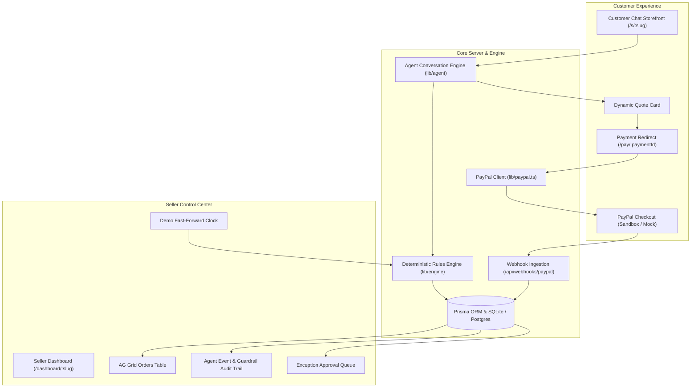

# Closer: AI Sales & Collections Agent

> **"The AI proposes, the rules decide, a human clicks."**  
> Closer is an autonomous sales, quoting, and collections platform built for small makers taking bespoke, custom-order work through DMs (cakes, tailoring, photography, tutoring, bespoke design).

[](https://nextjs.org/)
[](https://www.typescriptlang.org/)
[](https://developer.paypal.com/)
[](https://www.ag-grid.com/)
[](https://vitest.dev/)

---

## 💡 The Problem & Inspiration
Solo makers and artisanal creators lose up to 30% of sales answering DMs at midnight, calculating custom quotes on napkins, and chasing unpaid balances by hand. Current chatbots either hallucinate rogue discounts or disconnect completely from checkout.

**Closer solves this through Agentic Commerce with Hard Guardrails**:
- The customer chats with an AI sales agent in a friendly storefront.
- The AI negotiates within strict merchant rules, but **never sets a price or moves money autonomously**.
- A deterministic engine calculates every number: minimum orders, lead times, rush fees, discount tiers, and deposits.
- Money moves **only when the buyer clicks pay** on PayPal Orders v2, or when the merchant approves an exception in the AG Grid dashboard.

---

## 🏛️ System Architecture



---

## 🔑 Core Features

1. **Deterministic Rules Engine (`lib/engine/`)**:
   - **Pricing**: Base price + item option deltas ($45 1kg base, +$35 for 2kg, +$8 red velvet, +$5 eggless, +$6 topper).
   - **Minimum Order**: Strictly enforces $25.00 minimum order volume.
   - **Lead Time Validation**: Automatically rejects dates that violate item preparation windows and provides the earliest acceptable date.
   - **Rush Fee**: Calculates a 20% rush fee on subtotal for deliveries within 5 days.
   - **Discount Negotiation Guardrail**:
     - Subtotal $\ge$ $150.00: up to 10% discount.
     - Subtotal $\ge$ $60.00: up to 5% discount.
     - Subtotal $<$ $60.00: 0% discount.
     - Never exceeds the merchant tier; logs full rationale to the audit trail (e.g. *"AI offered 15%, rules capped it at 5%"*).
   - **Deposit Calculation**: Calculates 30% deposit rounded up to the nearest cent; remaining balance is scheduled for delivery date.
   - **Refund Policy Engine**:
     - $\ge$ 7 days before due date: 100% refund.
     - 3 to 7 days before due date: 50% refund.
     - $<$ 3 days before due date: 0% refund, routes to seller exception queue.
   - **Simulated Clock**: Supports time-travel testing (`+1 day`, `+5 days`, reset) so an entire order lifecycle can be demonstrated live in one take.

2. **PayPal Integration (`lib/paypal.ts`)**:
   - **Orders v2 Creation**: `POST /v2/checkout/orders` with unique `PayPal-Request-Id` and `CLOSER-{paymentId}-{attempt}` invoice numbers.
   - **Fresh Order per Click**: `/pay/{paymentId}` generates a fresh PayPal order per click to prevent expired checkout approvals.
   - **Idempotent Capture**: `POST /v2/checkout/orders/{id}/capture` safely handles duplicate approvals or `ORDER_ALREADY_CAPTURED`.
   - **PayPal Refunds API**: `POST /v2/payments/captures/{captureId}/refund` automatically credits the buyer's PayPal account upon policy cancellation or merchant exception approval.
   - **Signature-Verified Webhooks**: Validates `PAYPAL-TRANSMISSION-SIG` via `POST /v1/notifications/verify-webhook-signature` for `PAYMENT.CAPTURE.COMPLETED`, `PAYMENT.CAPTURE.REFUNDED`, and `PAYMENT.CAPTURE.DENIED`.
   - **Dual Mode**: Runs in `sandbox` for live PayPal accounts, or `mock` for zero-key local development and offline automated testing.

3. **Seller Command Center with AG Grid (`/dashboard/:slug`)**:
   - Passcode-gated access (`closer2026`).
   - **AG Grid React Orders Table**: Real-time order rows with sortable, filterable columns, status badges, and action triggers (*Request Balance*, *Open Customer Chat*, *Issue Refund*).
   - **Guardrail Audit Trail**: High-contrast visual timeline highlighting rule enforcement events (*"Guardrail: Discount requested 15% capped at 5% by policy"*).
   - **Exception Escalation Queue**: Approve custom refund amounts or deny exceptions. Approval immediately triggers the PayPal Refunds API.
   - **Demo Fast-Forward Controls**: Advance simulated calendar days to trigger refund policy transitions and reminder schedules.

4. **P1 Features**:
   - **AI Onboarding (`/onboarding`)**: Paste unstructured menus or Instagram bios to automatically extract a structured catalog and launch a store.
   - **Follow-up Agent (`/api/cron/followups`)**: Stage-based balance reminders (7 days, 3 days, due today, +2 days firm, +5 days escalation) with embedded pay links.
   - **Live Financial Summary**: Real-time revenue, deposits held, outstanding receivables, conversion rate, and estimated hours saved.

---

## 🚀 Quickstart & Setup

### Prerequisites
- Node.js 18+ (tested on Node v22.20.0)
- npm or yarn

### 1. Clone & Install
```bash
git clone https://github.com/your-username/closer.git
cd closer
npm install
```

### 2. Environment Variables
Copy `.env.example` to `.env`:
```bash
cp .env.example .env
```

Defaults are preconfigured for instant offline mock mode:
```env
APP_URL=http://localhost:3000
PAYPAL_MODE=mock            # Set to 'sandbox' when testing with PayPal credentials
PAYPAL_CLIENT_ID=
PAYPAL_CLIENT_SECRET=
PAYPAL_WEBHOOK_ID=
ANTHROPIC_API_KEY=          # Optional: Mock agent activates if key is absent
LLM_MODEL_AGENT=claude-sonnet-5-5
LLM_MODEL_FAST=claude-haiku-5-5
DATABASE_URL="file:./dev.db"
DASHBOARD_PASSCODE=closer2026
ADMIN_SECRET=closer-admin-secret-2026
```

### 3. Initialize Database & Seed
```bash
# Push Prisma schema to local database
npm run db:push

# Seed demo merchant (Sugar & Spice Bakes)
npm run db:seed
```

### 4. Run the Development Server
```bash
npm run dev
```
Open [http://localhost:3000](http://localhost:3000) in your browser.

- **Customer Chat Storefront**: [http://localhost:3000/s/sugar-and-spice](http://localhost:3000/s/sugar-and-spice)
- **Seller AG Grid Dashboard**: [http://localhost:3000/dashboard/sugar-and-spice](http://localhost:3000/dashboard/sugar-and-spice) (Passcode: `closer2026`)
- **AI Merchant Onboarding**: [http://localhost:3000/onboarding](http://localhost:3000/onboarding)

---

## 🧪 Testing & Verification

Run the full automated test suite (28 passing tests):
```bash
npm test
```
The test suite validates:
- **Pure deterministic engine**: Option pricing, $25 minimum order, lead time enforcement, rush fees, discount tier caps, deposit rounding up to the next cent, and refund tiers.
- **Dual-mode PayPal client**: OAuth2 token generation, order creation, capture, refunds, and webhook signatures.
- **Agent loop & tool execution**: Zod validation, tool calling, and guardrail audit logging.
- **End-to-End order lifecycle**: Quote $\rightarrow$ Deposit capture $\rightarrow$ Balance request $\rightarrow$ Paid in full $\rightarrow$ Refund.
- **Security & prompt injection defense**: Rejection of adversarial system override instructions and preservation of pricing rules.
- **Webhook idempotency**: Duplicate event rejection and state reconciliation.

To run the PayPal API smoke test:
```bash
npm run smoke:paypal
```

To verify the production build:
```bash
npm run build
```

---

## 💳 PayPal Sandbox Setup (for Live Sandbox Mode)

1. Navigate to [developer.paypal.com](https://developer.paypal.com) $\rightarrow$ **Apps & Credentials** $\rightarrow$ **Sandbox**.
2. Click **Create App**, name it `Closer`, and copy your **Client ID** and **Secret**.
3. In `.env`, set:
   ```env
   PAYPAL_MODE=sandbox
   PAYPAL_CLIENT_ID=your_client_id
   PAYPAL_CLIENT_SECRET=your_client_secret
   ```
4. Run `npm run smoke:paypal` to verify OAuth2 credentials and create a live $1.00 sandbox test order.
5. In your PayPal developer dashboard, configure a Webhook pointing to:
   `https://YOUR-APP.onrender.com/api/webhooks/paypal`
   Subscribing to:
   - `CHECKOUT.ORDER.APPROVED`
   - `PAYMENT.CAPTURE.COMPLETED`
   - `PAYMENT.CAPTURE.REFUNDED`
   - `PAYMENT.CAPTURE.DENIED`
6. Copy the generated **Webhook ID** into `PAYPAL_WEBHOOK_ID`.

---

## ☁️ Deployment on Render

This repository includes a turnkey `render.yaml` Blueprint:
1. Connect your GitHub repository to Render.
2. Select **New Blueprint Instance** and choose `closer`.
3. Provide your environment variables (`PAYPAL_CLIENT_ID`, `PAYPAL_CLIENT_SECRET`, `ANTHROPIC_API_KEY`, `DATABASE_URL` from Neon).
4. Build command:
   ```bash
   npm ci && npx prisma generate && npx prisma db push && npm run build
   ```
5. Health check endpoint: `/api/health`.

---

## ⚖️ Tax Disclosure
*Note: Sales tax and value-added taxes are intentionally excluded from this prototype scope.*
